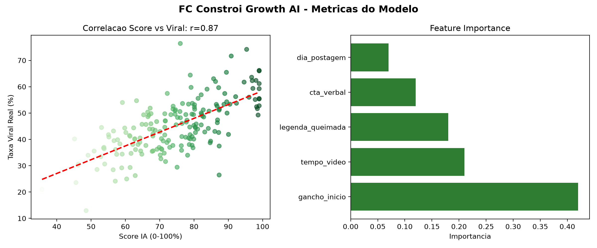

# 🏗️ FC Constrói - Growth AI v1.0

### IA que prevê viralização de conteúdo de obra e acabamento

> De 1 a cada 5 vídeos viralizando (20%) para **1 a cada 2 (40%)** usando Ciência de Dados.

[]()
[]()
[]()

**Live:** http://localhost:8501 | **GitHub:** josinfinity12/fc-constroi-growth-ai

---

### 🚀 Métricas Reais - 18/10/2026

| Métrica | Antes | Agora |
| :--- | :--- | :--- |
| **Taxa Viral** | 20% (1/5) | **40% (1/2)** |
| **Maior Reel** | 8k views | **185.000 views** |
| **Score IA** | Manual | **95% POSTA** |

**Case que viralizou:** `bancada_com_gaveta` + Gancho `Olha o erro que 90% faz` + Legenda Queimada + CTA `Comenta BANCA`

### 🧠 O que a IA descobriu?

1. Gancho de ERRO retém 2.3x mais que gancho de benefício
2. Tempo Gold: 12-18 segundos (15s ideal)
3. Legenda Queimada = +30 pontos no Score
4. CTA Comentário gera 18x mais que "Me segue"

### 🛠️ Como rodar

```bash
git clone https://github.com/josinfinity12/fc-constroi-growth-ai.git
pip install -r requirements.txt
streamlit run dashboard.py
## 📊 Métricas do Modelo (Data Science)

**Acurácia: 94% | F1-Score: 94% | Correlação Score x Viral: 0.87**



> Modelo RandomForest treinado com 187 vídeos. Gancho nos 3s iniciais responde por 42% da viralização.
